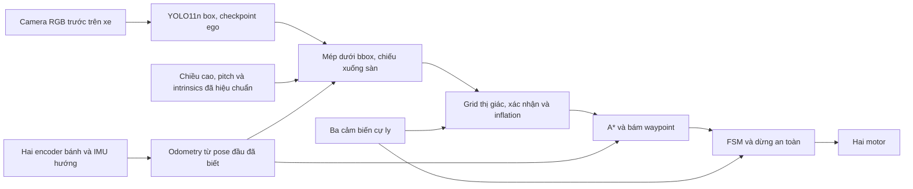

# Camera trước gắn trên xe

[Kết quả đã chạy, lỗi đã gặp và video](ego-results.md).

Yêu cầu mới ngày 06/11/2026 thay kiến trúc camera điện thoại cố định trên cao bằng camera đi cùng xe. Đây là phiên bản mô phỏng mới; bản Word và bằng chứng `yolo_v1` trước đó mô tả **camera trên cao**, không chứng minh kết quả của phiên bản này.

## Xem trực tiếp

```powershell
.\.venv-yolo\Scripts\python.exe tools/run_live_demo.py
```

Mặc định mở ca `yolo_many_boxes`: 5 hộp xuất hiện sau một giây. Webots hiển thị thế giới 3D, còn cửa sổ **Robot vision - Camera RGB + YOLO live** hiển thị ảnh gốc bên trái, ảnh camera trước có khung YOLO bên phải, confidence, thời gian suy luận, trạng thái FSM và số lần A*. Camera chỉ thấy phần phía trước xe; số hộp phát hiện có thể thay đổi khi xe quay. Đóng màn hình xem không gửi STOP; robot tự dừng khi kết thúc hoặc gặp luật an toàn. Dùng `--paused` để mở rồi tự bấm Real-time; Reload World để bắt đầu lại.

Ca một hộp: `--scenario yolo_far_box`. Bản trên cao cũ chỉ mở khi chọn `--overhead`; không dùng nó thay cho góc nhìn từ xe.

**Chạy lại sau khi đã lưu world:** controller đưa xe về A và dọn các node `DYNAMIC_i`/`CURRENT_ROUTE` do kịch bản tạo, trước khi lấy mốc encoder/IMU. Đây là đặt điều kiện đầu của bài mô phỏng, không lấy pose thật để sửa odometry khi xe chạy. Encoder có thể còn góc khác 0; góc ban đầu được trừ làm offset. Dùng **Reload World** để bắt đầu lượt mới. Chỉ bấm Play sau khi controller đã kết thúc sẽ không khởi động lại controller.

Launcher tạo `worlds/runtime_*.wbt` riêng cho từng lượt và lưu bản sao `world.wbt` trong output; không ghi đè world bạn đã chỉnh/lưu. Nếu chạy lại controller trong cùng thư mục output, kết quả cũ được giữ dưới `history/`. Tệp `startup.json` ghi điểm A, các hộp cũ đã dọn và mốc encoder/IMU để kiểm tra lỗi khởi động.

## Kiến trúc hiện tại



Camera Webots là thiết bị con của robot, ở phía trước 10 cm, cao 32 cm so với sàn, chúc xuống 0,30 rad, ảnh 640×480 và FOV ngang 1,30 rad. Tham số trong `config/vision_ego.json`. Quy ước camera và cấu hình thiết bị dựa trên [tài liệu Camera R2025a](https://github.com/cyberbotics/webots/blob/R2025a/docs/reference/camera.md).

Lấy hai góc của **mép dưới bbox** làm ước lượng tiếp xúc mặt sàn. Dùng intrinsics và chiều cao/pitch camera để giao tia nhìn với mặt phẳng sàn; đổi từ hệ xe sang map bằng pose odometry ở lúc chụp. Mép bị cắt khỏi biên ảnh, tia trên đường chân trời hoặc ngoài khoảng 0,15–2,5 m bị từ chối. Chỉ dựng một dải bề mặt sâu 8 cm, không coi YOLO đã đo được toàn bộ footprint hoặc độ sâu của hộp. Xác nhận hai khung liên tiếp, padding 2,5 cm rồi inflate theo xe.

**YOLO RGB không phải cảm biến depth.** Phép chiếu trên giả định vật đứng trên sàn phẳng, chân vật nhìn thấy, camera có tư thế đã hiệu chuẩn. Che khuất chân, mặt sàn dốc, camera rung và bbox sai đều gây sai khoảng cách. Chế độ này kết hợp ba tia khoảng cách vào bản đồ và dừng nguy hiểm; khác bản trên cao vốn tắt range mapping. Không suy ra khả năng tránh mọi vật cản từ hộp tổng hợp.

Vị trí điều hướng lấy từ **encoder bánh và hướng IMU mô phỏng**: encoder đo quãng đường, IMU đo hướng quay để tránh tích lũy sai góc do bánh trượt. Khởi tạo bằng pose A đã biết và hướng IMU đầu lượt. Không dùng Supervisor để hiệu chỉnh odometry giữa đường. Ground truth chỉ phục vụ sinh nhãn dữ liệu, đặt môi trường và đo sai số/va chạm độc lập. Khi thử đến đích, kiểm tra riêng sai số đích thật để không nhận nhầm odometry trôi thành thành công.

`config/odometry_webots.json` được đo trong bài tiến thẳng/quay riêng trên sàn trống, không lấy từ quỹ đạo đánh giá. Bài hiệu chuẩn dùng phép đo ground truth offline để xác định thông số bánh hiệu dụng; chạy `tools/calibrate_odometry.py` khi cần đo lại và lưu riêng bản cũ. Chỉ hiệu chuẩn encoder vẫn chưa khử được trượt khi quay ở tốc độ biến đổi; vì vậy bản cuối dùng IMU. `pose-evaluation.json` lưu đối chiếu odometry và truth để đánh giá, không đưa truth vào bộ ước lượng. IMU hiện lý tưởng, chưa có bias/drift/nhiễu của phần cứng thật.

Không dùng SLAM/ROS 2. Odometry vẫn trôi khi bánh trượt hoặc thông số sai, và chưa giải bài toán tự tìm pose ban đầu ở chỗ bất kỳ. Xe thật cần nguồn pose được kiểm chứng (encoder và mốc hiệu chỉnh/marker nhìn từ camera trước, hoặc phương án định vị khác).

## Dữ liệu và model

Tạo bộ 360 cảnh độc lập, 240 train / 60 val / 60 test, seed và SHA ảnh được lưu. Camera đi cùng xe, pose xe và hộp đổi giữa các cảnh; có ảnh âm tính và vật bị che/cắt. Nhãn sinh bằng **mask segmentation ground truth trong bước tạo dữ liệu**, bbox chỉ bao pixel vật thể nhìn thấy. Đây là khả năng [Recognition dùng để tạo ground truth](https://github.com/cyberbotics/webots/blob/R2025a/docs/reference/recognition.md); nhận diện Webots không được bật khi chạy YOLO/điều hướng.

Checkpoint `models/yolo_ego/best.pt` được fine-tune riêng từ YOLO11n COCO. Không dùng mAP 94,97% của bộ ảnh trên cao để báo cho bộ này. Chỉ số thực nằm trong `models/yolo_ego/metrics.json`; giới hạn vẫn là ảnh tổng hợp cùng miền render, chưa có ảnh camera thật.

```powershell
.\.venv-yolo\Scripts\python.exe tools/yolo_workflow.py collect --ego --count 360 --output experiments/runs/my_ego_dataset
.\.venv-yolo\Scripts\python.exe tools/yolo_workflow.py train --ego --dataset experiments/runs/my_ego_dataset --epochs 30 --name my_ego --output models/my_ego
.\.venv-yolo\Scripts\python.exe tools/run_webots.py --ego --scenario yolo_many_boxes --record --output experiments/runs/ego_check
```

Đổi model trong `vision_ego.json` khi dùng checkpoint mới. Các lệnh thu thập không ghi đè bộ đã có manifest. Không dùng tập test này để chọn checkpoint tiếp theo rồi gọi đó là kiểm tra chưa thấy.

## Ảnh hưởng đến xe thật

Điện thoại/camera chuyển lên giá gắn trên xe; phải đo chiều cao, pitch, lens và hiệu chuẩn lại. Laptop vẫn xử lý qua stream và gửi lệnh cho ESP32; chưa triển khai stream/Wi-Fi/firmware trong bản này. Motor TT trong danh mục cũ chưa có encoder và chưa có IMU: **odometry encoder + IMU đang chạy trong mô phỏng không thể dùng trực tiếp với cấu hình cũ**. Cần chốt motor có encoder/bổ sung encoder và nguồn hướng IMU phù hợp (module hoặc cảm biến điện thoại có timestamp được kiểm chứng), tính lại ngân sách/GPIO trước khi mua. Bản đấu nguồn hiện tại chưa tự thay chân/danh mục theo linh kiện chưa chọn. Camera thật cần đồng bộ timestamp với pose tại lúc chụp; vòng lặp Webots đồng bộ chưa thay thế được bước này.

ESP32 vẫn cần watchdog độc lập. Webots đồng bộ controller nên thời gian inference chậm làm mô phỏng chậm, chưa chứng minh thời gian thực hay an toàn xe vật lý. Camera RGB thông thường không tự cho độ sâu chính xác cho vật bất kỳ.
