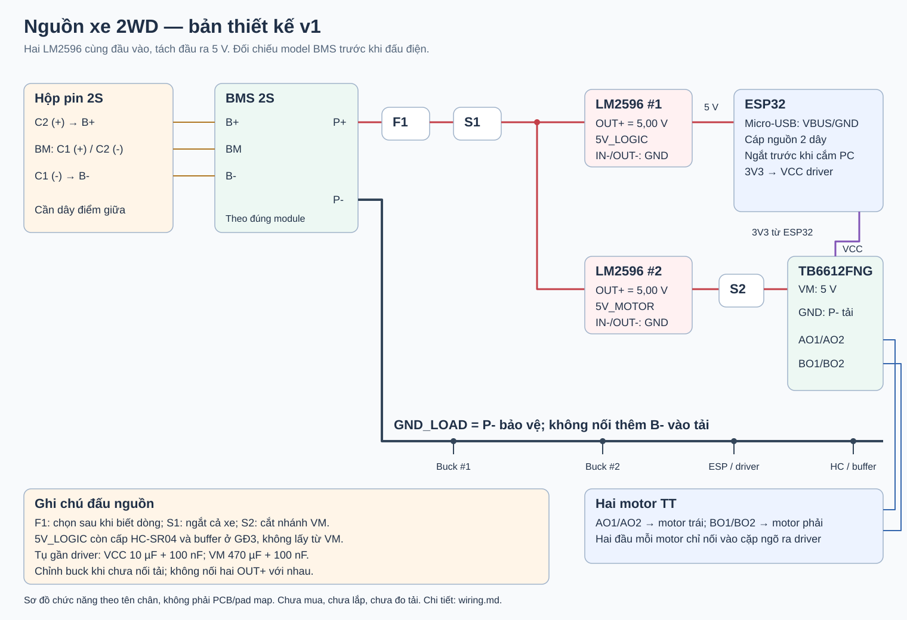
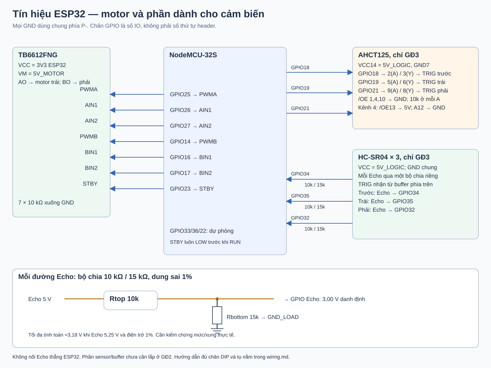

# Đấu nối và lắp thử xe 2WD

Thiết kế v1, ngày 06/11/2026. Người dùng xác nhận **chưa mua linh kiện**. Tài liệu này cụ thể hóa cấu hình đã chốt trong Word để chuẩn bị M6–M7; chưa phải biên bản xe đã lắp hoặc đã thử điện.



Nguồn cấu hình có thể đọc bằng chương trình: [`config/hardware_v1.json`](../../config/hardware_v1.json). Bảng tín hiệu và biểu mẫu: [GPIO](gpio.csv), [trình tự lắp](assembly-checklist.csv), [nhật ký đo](measurement-log.csv). Sơ đồ thể hiện các đầu nối theo **tên chân**, không thể hiện vị trí vật lý của pad trên module bất kỳ.

## 1. Những lựa chọn đã cụ thể hóa

| Hạng mục | Lựa chọn cho bản lắp thử |
|---|---|
| ESP32 | Ai-Thinker NodeMCU-32S CH340, ESP32 cổ điển, 38 chân; đối chiếu chữ in trên bo |
| LM2596 số 1 | Chỉnh **5,00 V**, cấp nhánh logic và cảm biến |
| LM2596 số 2 | Chỉnh **5,00 V**, cấp riêng VM của driver và hai motor |
| TB6612FNG VCC | Lấy **3V3 từ ESP32**, không lấy 5 V |
| Motor trái | Kênh A: AO1/AO2; nhìn theo hướng xe tiến |
| Motor phải | Kênh B: BO1/BO2 |
| Điều khiển motor | 7 dây logic 3,3 V; mỗi dây có điện trở 10 kΩ kéo xuống GND |
| HC-SR04 | Dành sẵn chân; chỉ lắp và kiểm thử ở giai đoạn 3 |
| Mạch phụ giai đoạn 3 | Ba bộ chia áp Echo; có phương án đệm TRIG bằng SN74AHCT125N |

**Lý do nguồn logic driver là 3,3 V:** ngưỡng HIGH phụ thuộc VCC; chọn nguồn này để khớp ESP32. STBY thấp làm ngõ ra ở trở kháng cao. Giá trị 1,2 A và xung 3,2 A là giới hạn tuyệt đối có điều kiện, không phải bảo đảm chạy hai motor liên tục ở các dòng đó. Bảng operating của IC nêu 1,0 A khi VM ≥ 4,5 V, không PWM; xung 3,2 A chỉ 10 ms đơn. Thiết kế phải tính nhiệt và dòng thực. [Datasheet Toshiba, bảng Operating/Absolute Maximum và Control](https://toshiba.semicon-storage.com/info/TB6612FNG_datasheet_en_20141001.pdf?did=10660&prodName=TB6612FNG).

Nguồn 5 V cho motor là lựa chọn ban đầu của thiết kế; thông tin bộ motor do nhà bán công bố nằm trong dải 3–9 V, nhưng **không cung cấp dòng kẹt**. Chưa thể xác nhận tương thích dòng của motor với driver chỉ từ dòng không tải. [Bộ TT motor đã chọn](https://hshop.vn/bo-dong-co-dc-giam-toc-tt-motor-kem-banh-xe-nhua-65mm).

## 2. Nối pin và BMS

Thiết kế giả định hai cell Li-ion loại sạc đầy 4,2 V/cell, nối tiếp thành 2S, tối đa 8,4 V. Kiểm tra đúng hóa học và giới hạn trên nhãn cell/bộ sạc mua thực tế.

Đặt tên **C1 là cell phía cực âm của pack**, C2 là cell phía cực dương:

```text
B-  = cực âm C1
BM  = cực dương C1 nối cực âm C2   (cũng có thể ghi B1 hoặc B/4.2V)
B+  = cực dương C2

BMS P+ -> F1 -> S1 -> chia tới IN+ của cả hai LM2596
BMS P- -----------> IN- của cả hai LM2596 và GND chung phía tải
```

Mua hộp pin 2S có đường lấy điểm giữa, hoặc đầu nối midpoint đã được chuẩn bị đúng. Hộp chỉ có hai dây đỏ/đen chưa đủ điểm nối BM. Không hàn trực tiếp lên vỏ cell. Dây BM là dây sense giữa hai cell, không phải GND cho tải.

Mã BMS hiện chưa có: sơ đồ dùng loại 2S có B+/BM/B- và đầu ra bảo vệ P+/P-. Đối chiếu tài liệu đúng module để biết pad, trình tự nối và cách kích hoạt. Một số mạch dùng chung pad B+/P+; không suy đoán vị trí pad từ hình sơ đồ. Nếu mạch có cổng sạc riêng, cần chỉnh bản vẽ theo đúng tài liệu của nó.

**Toàn bộ GND phía tải quy về P-; không nối thêm B- sang GND tải**, vì có thể bỏ qua phần bảo vệ phía âm của BMS. F1 đặt ở dây dương được bảo vệ, gần nguồn; S1 ngắt cả hai nhánh. Dòng định mức của F1, dây và công tắc phải chọn sau khi biết dòng khởi động/tải, khả năng ngắt DC và giới hạn của pin/BMS; ô này để trống trong cấu hình.

Công tắc có sẵn trên hộp có thể cắt dây pin trước BMS. Không mặc định nó là S1 trong bản vẽ: S1 ở **phía tải sau P+**, không ngắt dây sense của BMS. Nếu công tắc hộp không đúng vị trí hoặc không đủ dòng, cần công tắc tổng phía tải riêng và hộp/đầu nối phù hợp.

Theo bộ sạc hai khe đã chọn trong Word: tắt S1, tháo cell khỏi xe và sạc từng viên bằng bộ sạc đúng loại. Không nối đầu ra bộ sạc từng viên vào pack 2S. Khi lắp lại, kiểm tra từng điện áp, cực tính và yêu cầu ghép cell của nhà sản xuất. BMS không thay thế bộ sạc, không mặc nhiên có cân bằng và không bảo đảm pin nào cũng phù hợp với nhau.

## 3. Hai nhánh hạ áp

Hai LM2596 mắc song song **ở đầu vào**, cùng nhận nguồn sau S1. Các đầu ra dương là hai net riêng:

| Net | Đi từ | Đến |
|---|---|---|
| `5V_LOGIC` | OUT+ LM2596 số 1 | Cáp nguồn Micro-USB của ESP32; VCC cảm biến và buffer khi lắp GĐ3 |
| `5V_MOTOR` | OUT+ LM2596 số 2 | S2 ngắt motor → VM TB6612FNG |
| `3V3` | Chân 3V3 trên ESP32 | VCC TB6612FNG |
| `GND_LOAD` | P- BMS, OUT-/IN- hai buck | GND ESP32, driver, cảm biến, buffer, điện trở kéo xuống/chia áp |

Không nối hai OUT+ với nhau. Không cấp motor từ chân 5V/3V3 ESP32. S2 là công tắc cắt nhánh VM để thao tác bàn thử; không thay cho kiểm chứng chức năng STOP của firmware. Tụ sau S2 có thể còn năng lượng trong một khoảng ngắn.

Chỉnh từng buck bằng đồng hồ khi **chưa nối ESP32/driver/motor**, rồi đo lại dưới tải. Chọn mức 5,00 V; mục tiêu đo DC `5V_LOGIC` 4,75–5,25 V và `5V_MOTOR` ban đầu 4,90–5,10 V. Đây là ngưỡng kiểm tra do dự án chọn, không phải chứng nhận chất lượng module. Theo dõi cả quá độ khi motor khởi động nếu có máy hiện sóng.

Dự trù tải thử nhánh logic **1 A** để có dự phòng; nhánh motor cần ít nhất tổng dòng chạy thực của hai motor và chịu được khởi động trong giới hạn đã đánh giá. Mục tiêu dòng chạy ban đầu của dự án là ≤0,6 A mỗi bên, không phải giới hạn dòng tự động. Chữ “3 A” của IC/module không chứng minh bo mua được cấp liên tục mức đó; phải kiểm tra linh kiện, tản nhiệt và sụt áp của cả module.

LM2596 chỉ hạ áp. Datasheet bản cố định 5 V được đặc tả với VIN từ 7 V trong điều kiện thử; bảng này không tự chứng minh module điều chỉnh giá rẻ hoạt động giống hệt. Vì pin 2S giảm áp khi dùng, đề xuất ban đầu dừng thử nếu nguồn **dưới 7,0 V lúc có tải**, hoặc nhánh logic không còn đạt ngưỡng, tùy điều kiện nào đến trước. Đây là mốc vận hành bảo thủ cần đo lại; không phải ngưỡng bảo vệ cell. Chưa có mạch/firmware giám sát pin nên ban đầu phải đo thủ công. [Datasheet TI LM2596](https://www.ti.com/lit/ds/symlink/lm2596.pdf).

## 4. Cấp nguồn và nạp chương trình cho ESP32

Nguồn di động đi vào **Micro-USB** bằng cáp nguồn hai dây/breakout chắc chắn, đúng VBUS 5 V và GND. Cách này bám theo cổng cấp nguồn được mô tả của đúng kit. Không tự suy ra chân VIN của một bo ESP32 khác dùng được giống nhau. [Kit NodeMCU-32S đã chọn](https://hshop.vn/kit-rf-thu-phat-wifi-ble-esp32-nodemcu-32s-ch340-ai-thinker).

- **Khi nạp/debug:** tháo cáp nguồn từ buck ra khỏi ESP32; dùng cáp dữ liệu USB từ laptop. Motor VM tắt ở lần nạp đầu. Nếu sau đó cấp VM từ pin khi debug, chỉ nối GND chung phía P-, không ghép đường dương 5 V từ buck vào USB laptop.
- **Khi chạy pin:** rút USB laptop, dùng cáp nguồn từ `5V_LOGIC` vào Micro-USB. Chỉ dùng một nguồn 5 V vào kit tại một thời điểm.
- Không để cảm biến 5 V hoạt động và đẩy Echo vào một ESP32 đang mất nguồn. Tắt/rút nhánh cảm biến khi đổi chế độ cấp nguồn.

## 5. Bảng GPIO và driver



Số dưới đây là **GPIO**, không phải số thứ tự chân cắm. Dùng chữ IOxx/Pxx trên bo, đối chiếu pinout đúng bản 38 chân. Chân 16/17 dành cho thiết kế ESP32-S đã chọn; nếu mua nhầm biến thể có PSRAM/bo khác thì cần kiểm tra lại. [Tài liệu NodeMCU-32S của Ai-Thinker, bản lưu nhà phân phối](https://robu-prod-media.s3.ap-south-1.amazonaws.com/uploads/2019/12/Ai-Thinker-NodeMCU-32S-ESP32-Development-Board.pdf).

| Nhóm | Chân ESP32 | Đầu nối | Trạng thái khi khởi động |
|---|---:|---|---|
| Trái | GPIO25 | PWMA | LOW |
| Trái | GPIO26 | AIN1 | LOW |
| Trái | GPIO27 | AIN2 | LOW |
| Phải | GPIO14 | PWMB | LOW |
| Phải | GPIO16 | BIN1 | LOW |
| Phải | GPIO17 | BIN2 | LOW |
| Cho phép driver | GPIO23 | STBY | LOW, chỉ bật sau khi firmware sẵn sàng |
| Dự phòng STOP nút nhấn | GPIO33 | Chưa nối trong bản này | Cần thiết kế nút và xử lý khi triển khai |
| Dự phòng đo pin | GPIO36 | Chưa nối; không đưa điện áp pack thẳng vào GPIO | ADC1, cần mạch chia áp riêng |
| Dự phòng | GPIO22 | Chưa nối | — |

Đặt 10 kΩ từ **mỗi dây trong bảy dây điều khiển driver xuống GND**. Nếu module có mạch kéo STBY lên nguồn, kiểm tra và xử lý phần kéo lên theo sơ đồ module; yêu cầu cuối cùng là STBY thực sự thấp khi reset/ESP32 chưa chạy. Không nối cứng STBY lên 3V3.

Pinout tránh các chân boot strapping, UART nạp và nhóm flash. GPIO34/35 chỉ dùng làm đầu vào Echo, không có pull nội; bộ chia áp bên dưới tạo đường kéo xuống ngoài. [Tài liệu GPIO chính thức Espressif](https://docs.espressif.com/projects/esp-idf/en/stable/esp32/api-reference/peripherals/gpio.html).

Nối AO1/AO2 vào hai đầu motor trái, BO1/BO2 vào hai đầu motor phải. Không nối một đầu motor trực tiếp GND. Nhãn module có thể in A01/A02 hoặc AO1/AO2; đối chiếu kênh. Chưa mặc định HIGH/LOW nào là xe tiến: thử một bánh khi kê xe lên, đổi hai dây của đúng motor hoặc đảo chiều trong cấu hình firmware khi cần.

Yêu cầu firmware cho bước M7 sắp tới: khởi động ở STOP, đặt PWM = 0 và STBY = 0 trước mọi hoạt động Wi-Fi, chỉ RUN khi được cho phép; mất lệnh hợp lệ quá **250 ms** thì trở về STOP. Chu kỳ lệnh đề xuất **50 ms**. Các mốc này là lựa chọn ban đầu của dự án, chưa đo trên xe.

Ở đây STOP dùng STBY = 0, ngõ ra thả nổi nên xe có thể trôi thêm; phải đo thời gian và quãng trôi thực tế. Chưa có firmware M7 hoặc client Wi-Fi trong lần bàn giao sơ đồ này.

## 6. Dây cảm biến dành cho giai đoạn 3

HC-SR04 trong danh mục là loại cấp 5 V. Không đưa Echo 5 V trực tiếp vào GPIO 3,3 V. [Thông tin đúng sản phẩm](https://hshop.vn/cam-bien-sieu-am-srf04).

| Hướng | GPIO phát TRIG | GPIO nhận Echo | Nguồn |
|---|---:|---:|---|
| Trước | 18 | 34 | `5V_LOGIC`, GND chung |
| Trái | 19 | 35 | `5V_LOGIC`, GND chung |
| Phải | 21 | 32 | `5V_LOGIC`, GND chung |

Mỗi Echo dùng một bộ riêng, điện trở dung sai 1%:

```text
Echo cảm biến ---- Rtop 10 kΩ ----+---- GPIO Echo ESP32
                                |
                            Rbottom 15 kΩ
                                |
                             GND_LOAD
```

Tính toán thiết kế: VGPIO = VEcho × 15/(10+15), bằng **3,00 V** nếu Echo 5,00 V. Với nguồn Echo giả định tối đa 5,25 V, điện trở 1% ở góc xấu, kết quả khoảng **3,18 V**. Đây là kết quả tính, cần đo/kiểm chứng mức HIGH và xung trên cảm biến nhận thực tế. Không đặt Rbottom nhầm phía Echo.

Phương án đệm TRIG khi chưa có thông số xác nhận ngưỡng đầu vào HC-SR04: dùng **SN74AHCT125N DIP-14**, cấp 5 V, nhận logic 3,3 V từ ESP32. Loại AHCT có ngưỡng HIGH 2 V tại nguồn hoạt động 4,5–5,5 V; không thay bằng 74HC125 rồi mặc định tương đương. Đây là phụ kiện GĐ3 bổ sung, chưa nằm trong báo giá linh kiện chính. [Datasheet TI, pinout và Recommended Operating Conditions](https://www.ti.com/lit/ds/symlink/sn74ahct125.pdf).

| Kênh buffer | Nối vào | Nối ra | Cho phép |
|---|---|---|---|
| 1, trước | GPIO18 → chân 2 (1A) | chân 3 (1Y) → TRIG trước | chân 1 (/1OE) → GND |
| 2, trái | GPIO19 → chân 5 (2A) | chân 6 (2Y) → TRIG trái | chân 4 (/2OE) → GND |
| 3, phải | GPIO21 → chân 9 (3A) | chân 8 (3Y) → TRIG phải | chân 10 (/3OE) → GND |
| Nguồn | chân 14 → 5V_LOGIC; chân 7 → GND | 100 nF giữa 14 và 7, đặt sát IC | — |
| Kênh 4 không dùng | chân 12 (4A) → GND | chân 11 (4Y) để trống | chân 13 (/4OE) → 5V_LOGIC |

Mỗi đầu vào A của ba kênh dùng thêm 10 kΩ xuống GND để không trôi khi reset. Đối chiếu notch/chấm chân 1 của vỏ DIP. Nếu mua module đệm thay vì DIP, dùng tên chân/module schematic, không áp số chân IC trực tiếp lên header module.

TRIG đi **qua buffer hoặc nối trực tiếp khi đã xác minh tương thích**, không mắc hai đường song song. Bảng/sơ đồ dùng phương án buffer. Khi triển khai, phát từng cảm biến lần lượt, có timeout hữu hạn và thời gian chống giao thoa; số đo lỗi không được xem như đường trống.

## 7. Phụ kiện và công cụ cần chuẩn bị

Giữ nguyên linh kiện chính trong Word. Làm rõ phần phụ kiện/dụng cụ chưa có mã hàng hoặc giá:

| Hạng mục | Số lượng thiết kế | Ghi chú |
|---|---:|---|
| Điện trở 10 kΩ 1% | 7 ở GĐ2; thêm 6 ở GĐ3 | 7 kéo xuống driver; 3 kéo xuống buffer; 3 Rtop Echo |
| Điện trở 15 kΩ 1% | 3, GĐ3 | Rbottom Echo |
| Tụ gốm 100 nF | Tối đa 8 để bố trí bổ sung | 2 sát driver, 2 ngang hai cực motor, 1 sát buffer, 3 sát cảm biến; trừ phần đã có phù hợp trên module |
| Tụ 10 µF ≥10 V | 1 gần VCC driver | Kiểm tra tụ đã có trên module trước khi bổ sung |
| Tụ 470 µF ≥16 V | 1 ở VM driver, sau S2 | Đúng cực; giá trị ban đầu của dự án, kiểm tra quá độ khi thử |
| SN74AHCT125N và đế/mạch hàn | 1, GĐ3 | Phương án TRIG bảo đảm mức logic |
| Cáp Micro-USB cấp nguồn hai dây | 1 | Không ghép hai nguồn USB |
| Cầu chì F1 + đế, công tắc S2, S1 đúng vị trí | 1 mỗi loại | Dòng định mức chờ dòng motor và dây; S1 riêng nếu công tắc hộp không đáp ứng |
| Dây nguồn, đầu nối, mạch hàn, co nhiệt | Theo bố trí | Đường motor không dùng dây jumper mảnh/breadboard làm đường công suất |
| Đồng hồ vạn năng | 1 | Bắt buộc để chỉnh và kiểm tra nguồn; không tính sẵn trong ngân sách Word |
| Nguồn bàn giới hạn dòng, tải giả, nhiệt kế | Mượn nếu có | Hỗ trợ kiểm tra trước khi dùng pin; không tự thử kẹt motor qua driver |

Mốc 661.000đ trong Word là dự toán cũ của linh kiện chính. Phụ kiện được cụ thể hóa ở đây chưa có báo giá; chưa xác nhận tổng chi phí cuối cùng hoặc tiến hành mua hàng.

## 8. Thứ tự lắp và điều kiện chuyển bước

1. **Trước khi mua:** xác nhận model BMS, hộp có BM, loại cell/sạc, dòng motor khi tải/khởi động/kẹt, dòng và nhiệt thực của buck/driver. Mục tiêu thiết kế dòng làm việc ban đầu ≤0,6 A/motor là mức dự án chọn, không phải bảo đảm tản nhiệt. Nếu dòng kẹt vượt khả năng driver hoặc vẫn chưa biết, chưa phê duyệt đấu VM; lấy thông số từ nhà bán/nhà sản xuất hoặc đo riêng bằng nguồn giới hạn dòng và phương pháp phù hợp.
2. **Khung và cơ khí, chưa điện:** lắp motor, hai bánh, bánh đỡ; bố trí pin thấp, marker nằm trên cao, dây tránh bánh; đo kích thước và khoảng cách tâm bánh vào nhật ký. Chưa lấy kích thước mô phỏng làm số đo thật.
3. **Nguồn riêng:** kiểm tra BMS theo đúng hướng dẫn của module, S1 tắt khi nối; sau đó chỉnh từng buck khi tải điện tử chưa nối. Ghi điện áp từng cell, pack, P+/P-, hai đầu ra. DMM ở thang V song song; không đặt đồng hồ ở thang dòng trực tiếp ngang pin/nguồn.
4. **ESP32 riêng:** dùng USB laptop, chưa cấp VM; xác nhận bo nạp được chương trình. Chỉ thử nguồn pin sau khi nhánh 5 V đã đo đạt; ghi 3V3 trên bo.
5. **Driver logic:** nối GND, VCC 3V3 và bảy tín hiệu/pulldown. Xác minh STBY thấp khi reset, trước kết nối Wi-Fi và khi tắt ESP32. Bước này cần firmware M7 ở lần triển khai tiếp theo.
6. **Một motor khi kê bánh khỏi sàn:** chỉ mở S2 sau khi dòng/nguồn được đánh giá; thử PWM thấp, đề xuất bắt đầu 10%, khoảng ngắn 0,5 giây. Nếu motor không quay, dừng để kiểm tra, không giữ trạng thái ù. Xác nhận chiều từng bên, STOP và dòng; không ghì trục để đo kẹt qua driver.
7. **Hai motor khi kê bánh:** thử tiến/lùi/xoay, thêm khoảng dừng trước đảo chiều; theo dõi hai rail khi khởi động và nhiệt driver/buck. Ghi kết quả, không dùng chữ “ổn định” thay số đo.
8. **Wi-Fi và lỗi:** kiểm tra START/STOP, ngắt Wi-Fi, đóng client và reset ESP32; ngõ ra phải ngừng điều khiển khi hết hạn lệnh. Đo độ trễ từ lệnh hợp lệ cuối đến PWM/STBY dừng. Chưa hạ xe xuống sàn nếu bước này chưa qua.
9. **Chạy sàn ngắn, tốc độ thấp:** dùng vùng trống có người giữ công tắc, đo quãng trôi sau STOP. Sau khi điều khiển thủ công và mất lệnh đều dừng đúng mới làm camera ArUco, hiệu chuẩn mét và waypoint thật.

Lưu các phép đo vào [measurement-log.csv](measurement-log.csv); đánh dấu từng bước trong [assembly-checklist.csv](assembly-checklist.csv). Tất cả các ô kết quả ban đầu để trống hoặc `NOT_RUN`.

## 9. Trạng thái bàn giao

Đã có sơ đồ chức năng nguồn/tín hiệu, phân chân và quy trình kiểm tra. Chưa có mã BMS/hộp/cell cụ thể, thông số dòng kẹt và dữ liệu tải thực nên chưa xác nhận bộ linh kiện sẵn sàng cấp điện. Chưa viết/nạp firmware M7, chưa điều khiển xe thật. Bộ mô phỏng giai đoạn 1 được giữ nguyên.
