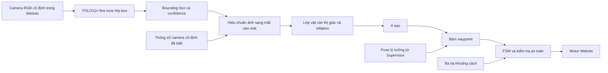

# YOLO nhận diện hộp cản trong Webots

Phần mở rộng giai đoạn 1 theo yêu cầu ngày 06/11/2026: bổ sung thành phần máy học vào hệ thống điều hướng. Bản đầu nhận diện **một lớp `box`** từ ảnh RGB của camera cố định trên cao. Chưa nhận diện mọi loại vật cản và chưa kiểm chứng với điện thoại thật.

## Kiến trúc



Camera được gắn trên một robot tĩnh riêng (`vision_camera`), mô phỏng điện thoại trên cao. Controller này nhận **ảnh thật từ Camera.getImage()**, chạy YOLO và gửi gói bounding box/confidence/timestamp qua Emitter. Controller điều hướng chỉ nhận các gói này bằng Receiver; không nhận tọa độ hộp từ bộ sinh kịch bản để dựng lớp thị giác.

Trong chế độ `--yolo`, các tia khoảng cách vẫn kiểm tra dừng nguy hiểm nhưng **không được cập nhật bản đồ**. Nhờ vậy, việc phát hiện hộp cho A* thực sự phụ thuộc vào ảnh và mô hình. Chế độ mặc định dùng cảm biến như trước vẫn chạy độc lập để làm đối chứng.

YOLO hỗ trợ nhận biết đồ vật trong ảnh, còn A* lập đường và FSM quyết định chuyển trạng thái. Chọn YOLO11n làm mô hình nhỏ để thử trên CPU, không khẳng định đây là phiên bản mới nhất hoặc tối ưu nhất cho mọi máy. [YOLO11](https://docs.ultralytics.com/models/yolo11/), [Detect](https://docs.ultralytics.com/tasks/detect/).

## Dữ liệu và huấn luyện

COCO có các lớp như người/ghế nhưng không có lớp hộp carton dùng ở đây. Vì vậy, không đổi nhãn một mô hình COCO rồi coi như đã nhận diện hộp. Bản đầu khởi tạo YOLO11n từ trọng số COCO và fine-tune một lớp `box`. [Danh sách COCO của Ultralytics](https://raw.githubusercontent.com/ultralytics/ultralytics/main/ultralytics/cfg/datasets/coco.yaml).

- 240 cảnh Webots được render độc lập: 160 train, 40 validation, 40 test.
- Thay đổi vị trí/kích thước/chiều cao/màu hộp, màu sàn và vị trí/hướng xe; có cảnh âm tính không có hộp.
- Nhãn YOLO sinh từ tám đỉnh hình hộp và phép chiếu camera **chỉ trong quá trình tạo tập dữ liệu**. Đây là dữ liệu tổng hợp có ground truth, không phải ảnh thực được gán nhãn thủ công.
- Mỗi cảnh có seed và hash; không chia các khung liền kề của một cảnh sang nhiều tập. Cả ba tập vẫn cùng miền render/camera nên đánh giá này không đo khả năng tổng quát hóa sang xe thật.
- Lần đầu huấn luyện 30 epoch trên CPU, ảnh 320, batch 8, seed 42, freeze 10 lớp đầu. Tham số thực, đường cong và checkpoint được lưu để đối chiếu. Seed không bảo đảm mọi lần chạy/máy cho kết quả bit-identical.

Các số đo sau huấn luyện nằm trong `models/yolo_box/metrics.json`; báo cáo tổng hợp và bằng chứng dưới `experiments/evidence/yolo_v1/`. Không dùng accuracy phát hiện đồ vật thay cho tỷ lệ robot hoàn thành nhiệm vụ.

## Hiệu chuẩn và cập nhật bản đồ

Camera RGB 640 × 480, cao 3,4 m, nhìn thẳng xuống; horizontal FOV = 1 rad. Bộ chuyển tọa độ dùng hình học camera cố định đã biết để đổi pixel thành mét. Đây là hiệu chuẩn giả định chính xác trong mô phỏng. Khi dùng điện thoại, phải thay bằng hiệu chuẩn đo được, xử lý méo ảnh và tư thế camera thực.

Chiếu bốn góc bounding box xuống mặt phẳng sàn rồi thêm padding 3 cm; rasterize thành ô occupancy và inflate theo bán kính xe cùng biên an toàn. Bounding box là vùng ảnh bao vật thể, không phải footprint sàn chính xác. Vật bị che, hộp cao và sai số detection/calibration có thể làm vùng ước lượng lệch hoặc quá rộng; cần đánh giá riêng khi chuyển sang ảnh thật.

Chỉ nhận nhãn `box` với confidence ≥0,5; mỗi ô cần quan sát ở **hai timestamp khác nhau liên tiếp**. Hai detection trùng trong cùng ảnh không được coi là hai lần xác nhận. Ô thị giác được giữ 2 giây kể từ lần xác nhận cuối. Ảnh sai kích thước/tọa độ, confidence lỗi, gói cũ hoặc phát lại không được bổ sung bằng chứng.

Không có ảnh mới quá 0,65 giây mô phỏng dẫn đến `SAFE_STOP`; trước ảnh hợp lệ đầu tiên xe giữ đứng yên, tối đa có 1 giây chờ khởi động. Webots đồng bộ các controller nên inference chậm làm mô phỏng chạy chậm theo đồng hồ thực; bài thử này **không chứng minh watchdog an toàn cho một xe vật lý khi chương trình laptop bị treo**. Xe thật vẫn cần watchdog độc lập trên ESP32.

## Cài và chạy

Lõi mô phỏng không bắt buộc cài YOLO. Môi trường thử hiện tại dùng Python 3.14.4 và `.venv-yolo` riêng:

```powershell
python -m venv --system-site-packages .venv-yolo
.\.venv-yolo\Scripts\python.exe -m pip install -r requirements-yolo.txt
.\.venv-yolo\Scripts\python.exe tools/run_webots.py --scenario yolo_far_box --yolo --output experiments/runs/yolo_demo
```

Launcher tạo `controllers/vision_camera/runtime.ini` trỏ về interpreter đang gọi lệnh, vì camera cần môi trường có Torch/OpenCV/Ultralytics. Tệp này chỉ dùng tại máy, được Git bỏ qua. Không dùng `--no-rendering` cho camera. Robot vẫn dùng pose Supervisor lý tưởng; YOLO chưa thay ArUco để định vị xe.

Tái tạo tập và huấn luyện từ đầu:

```powershell
.\.venv-yolo\Scripts\python.exe tools/yolo_workflow.py collect --count 240 --output experiments/runs/my_yolo_dataset
.\.venv-yolo\Scripts\python.exe tools/yolo_workflow.py train --dataset experiments/runs/my_yolo_dataset --epochs 30 --name my_box_run --output models/my_box
```

Đổi `config/vision.json` để chọn model mới. Lệnh train tải trọng số COCO khi chưa có, cần Internet ở lần đầu; suy luận bằng checkpoint đã lưu chạy tại máy. Lệnh collect từ chối ghi đè tập đã có manifest để giữ provenance. Model thử đầu tiên có thể rất tốt trên cảnh đơn giản cùng kiểu render mà vẫn kém trên vật thật.

```powershell
python -m unittest discover -s tests -v
python tools/run_webots.py --all
.\.venv-yolo\Scripts\python.exe tools/run_webots.py --scenario yolo_camera_loss --yolo --output experiments/runs/yolo_fault
```

Các file đầu ra gồm `detections.jsonl`, ảnh RGB có khung YOLO, `camera-calibration.json`, lớp `map_vision.csv`, lịch sử FSM và đường A*. `models/yolo_box/` lưu checkpoint cùng tham số và kết quả test.

## Thành phần sử dụng và phạm vi nghiên cứu

Ultralytics cung cấp mô hình YOLO và trọng số khởi tạo; tham khảo [giấy phép của dự án](https://github.com/ultralytics/ultralytics/blob/main/LICENSE). Công việc của project là tạo dữ liệu mô phỏng, fine-tune, hiệu chuẩn, ghép lớp thị giác với bản đồ/FSM/A* và đánh giá. Không gọi đây là đề xuất một kiến trúc YOLO mới hoặc cải tiến trực tiếp CamShift của bài báo nền.

Kết quả synthetic hiện là bước kiểm chứng tích hợp. Trước nghiệm thu xe thật cần dữ liệu camera điện thoại độc lập, nhãn kiểm tra, thử điều kiện sáng/che khuất và so sánh các cấu hình có/không có lớp thị giác.
