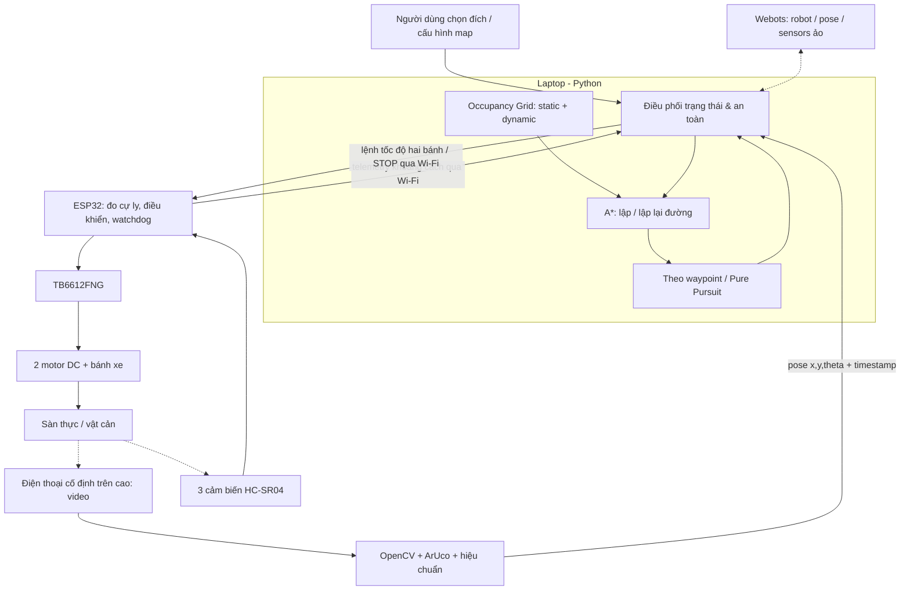

# AGENTS.md — Ngữ cảnh dự án robot tự hành mini

**Yêu cầu thay đổi sau kế hoạch gốc (06/11/2026):** người dùng yêu cầu camera trước gắn trên xe và đã cho triển khai. Kiến trúc camera trên cao/ArUco trong kế hoạch bên dưới nay là lịch sử. Mã ego mới tại `src/robot_nav/onboard.py`, `webots_ego.py`; cấu hình `config/vision_ego.json`, hướng dẫn `docs/ego-vision.md`. Mô phỏng dùng odometry encoder + IMU và pose đầu biết trước, chưa có SLAM; phần cứng TT ban đầu chưa có encoder/IMU nên cần chọn nguồn pose thật trước khi mua. Báo cáo Word và bằng chứng `yolo_v1` vẫn là kết quả camera trên cao.

> **Dành cho coding/research agent.** Đọc file này trước khi thiết kế, tạo mã nguồn hoặc đề xuất mua linh kiện. Đây là **đặc tả kế hoạch**, không phải mô tả một hệ thống đã triển khai. Toàn bộ kết quả, ngân sách và ngưỡng nghiệm thu dưới đây là **dự kiến**, trừ khi có bằng chứng kiểm thử thực tế được bổ sung.

**Cập nhật triển khai 06/11/2026:** đã có mã nguồn giai đoạn 1 tại thư mục gốc project. `README.md` hướng dẫn chạy, `docs/stage1-results.md` ghi số đo và `experiments/evidence/` chứa bằng chứng. Bộ 10 ca 2D và Webots đều đúng kỳ vọng (8 đến đích, 2 `NO_PATH`), thêm ca cản mới đóng cửa dừng `NO_PATH`; 14 test qua. Chỉ xác nhận mô phỏng, chưa có xe thật. Bản đầu dùng waypoint controller, tốc độ/ngưỡng và giao diện bánh m/s theo `config/robot.json`; đây chưa phải thông số cho xe thật. Các phần kế hoạch bên dưới giữ vai trò định hướng; kết quả đo mới nằm trong báo cáo.

**Chuẩn bị M6–M7:** người dùng yêu cầu thiết kế đấu nối và xác nhận chưa mua linh kiện. Đã có `docs/hardware/wiring.md`, sơ đồ nguồn/tín hiệu và bảng GPIO theo `config/hardware_v1.json`. BMS/hộp/cell cụ thể và dòng kẹt motor còn cần xác minh. Chưa có firmware M7, chưa mua/lắp hoặc thử điện; không coi trạng thái phase 2 là đã hoàn thành nghiệm thu giai đoạn 2.

**Mở rộng thị giác theo yêu cầu mới:** đã dùng YOLO11n fine-tune lớp box từ 240 ảnh RGB Webots (160/40/40). Chỉ số test 40 ảnh tổng hợp: mAP50–95 khoảng 94,97%; 4 ca tích hợp đúng kỳ vọng, 23 test qua. Xem `docs/yolo.md`, `reports/Bao_cao_giai_doan_1_YOLO.docx`, `experiments/evidence/yolo_v1/`. Chưa có ảnh camera thật; không lấy kết quả này thay số liệu xe thật. Phần YOLO nay được người dùng yêu cầu; các giới hạn ban đầu dưới đây là lịch sử kế hoạch, không hủy yêu cầu mới này.

## 0. Quy tắc sử dụng tài liệu

- **Ngôn ngữ giao tiếp:** tiếng Việt; có thể dùng thuật ngữ tiếng Anh chuẩn (A*, occupancy grid, pose, waypoint, Pure Pursuit, watchdog).
- **Ưu tiên:** an toàn điện và an toàn di chuyển > chức năng cốt lõi > độ chính xác > tính năng mở rộng > hình thức.
- **Không tự nhận đã hoàn thành** mô phỏng, lắp xe, mua linh kiện, đạt KPI hoặc kiểm nghiệm thuật toán khi chưa có log/bằng chứng.
- **Phân biệt rõ:** `ĐÃ CHỌN` = định hướng nhóm muốn dùng; `ĐỀ XUẤT` = thông số/giải pháp có thể thay đổi; `CHƯA CHỐT` = cần thử nghiệm hoặc xác nhận.
- **Trước khi viết code:** đọc mục tiêu và tiêu chí nghiệm thu của giai đoạn hiện tại; không triển khai các phần mở rộng như SLAM, YOLO, ROS 2 hay LiDAR nếu chưa được yêu cầu.
- **Sau khi viết code:** kèm hướng dẫn chạy, ví dụ dữ liệu đầu vào/đầu ra, cách kiểm thử và giới hạn đã biết. Ưu tiên code Python có thể chạy riêng, kiểm thử được khi chưa có xe thật.

## 1. Tóm tắt dự án

**Tên đề tài làm việc:** Xây dựng hệ thống điều hướng robot di động tự hành đến đích trong môi trường có vật cản.

**Mục tiêu:** Người dùng chọn điểm đích **B** trên bản đồ sàn 2D có sẵn. Robot 2 bánh chủ động (2WD) tự xác định vị trí, dùng **A\*** lập đường từ vị trí hiện tại **A** đến **B**, điều khiển bám đường, phát hiện vật cản phát sinh, **cập nhật bản đồ và lập lại đường** khi cần. Khi không còn đường an toàn, robot dừng và báo lỗi thay vì cố đi tiếp.

**Bối cảnh:** Niên luận cơ sở ngành Khoa học máy tính; chi phí thấp; tận dụng laptop và điện thoại sẵn có; triển khai **mô phỏng trước, xe thật sau**; thử trên sàn phẳng trong nhà và vật cản như hộp, tường, chân bàn/chân ghế.

**Đã chọn:**

1. Bài toán chính là **điều hướng đến đích trên bản đồ biết trước**, không phải chạy ngẫu nhiên và không bắt buộc bám một đường đua F1 cố định.
2. Không có vạch dẫn đường trên nền sàn.
3. Máy tính xách tay xử lý thuật toán; điện thoại đặt **cố định trên cao** quay khu vực thử nghiệm; ESP32 gắn trên xe điều khiển động cơ qua Wi-Fi.
4. Phần mềm mô phỏng: **Webots**; thuật toán chính: **Python, Occupancy Grid Map, A\*, điều khiển waypoint/Pure Pursuit**; định vị thực: **OpenCV + ArUco**.
5. Bản đầu **không làm SLAM**, không tự khám phá phòng chưa biết; không mua Raspberry Pi, LiDAR, camera chuyên dụng, encoder hoặc IMU nếu chưa có nhu cầu đo được.

**Tính năng mở rộng, chưa phải yêu cầu bắt buộc:** chọn nhiều checkpoint tuần tự (chạy kiểu F1), Kalman lọc pose, so sánh ArUco với CamShift, cải tiến bộ bám đường, thay siêu âm bằng ToF.

## 2. Phạm vi và giả định

| Hạng mục | Giá trị/giới hạn | Trạng thái |
|---|---|---|
| Khu vực thử nghiệm | Khoảng **2 × 3 m** trên sàn phẳng, tùy góc nhìn camera | ĐỀ XUẤT |
| Xe | 2WD, hai động cơ DC giảm tốc, bánh tự do | ĐÃ CHỌN |
| Bản đồ | Lưới occupancy grid tĩnh + lớp vật cản động tạm thời | ĐÃ CHỌN |
| Kích thước ô lưới | Khởi đầu **0,10 m/ô**, cần thử với kích thước xe | ĐỀ XUẤT |
| Kích thước xe | Khởi đầu khoảng **18 × 15 cm** | GIẢ ĐỊNH, đo sau khi lắp |
| Đường kính bánh | **65 mm** theo bộ bánh dự kiến | ĐỀ XUẤT |
| Khoảng cách hai bánh | Khởi đầu **~12 cm** | GIẢ ĐỊNH, phải đo thực tế |
| Pose | `(x_m, y_m, theta_rad)` + thời điểm + độ tin cậy | ĐỀ XUẤT HỢP ĐỒNG DỮ LIỆU |
| Camera | Điện thoại phía trên, thấy rõ marker trên nóc xe | ĐÃ CHỌN |
| Vận tốc | Thấp; giới hạn được bằng cấu hình; xác định bằng thử nghiệm an toàn | CHƯA CHỐT |

**Giới hạn cần trình bày trung thực:** camera ngoài không định vị được xe nếu marker bị che hoặc xe ra khỏi vùng nhìn; HC-SR04 có điểm mù và có thể bỏ sót chân ghế mảnh/nghiêng; mô hình ảo khác xe thật do ma sát, trượt bánh, độ trễ mạng, nguồn và nhiễu đo. Không hứa tránh vật cản 100%.

## 3. Kiến trúc hệ thống



**Hai chế độ dữ liệu, một lõi thuật toán:**

- `simulation`: Webots cung cấp pose lý tưởng và số đo cảm biến ảo; chương trình gửi lệnh chuyển động vào mô hình động học robot Webots.
- `real`: OpenCV cung cấp pose xe từ marker; ESP32 cung cấp khoảng cách; chương trình gửi lệnh đến ESP32 qua Wi-Fi.
- **Giữ nguyên** bản đồ, A*, quản lý trạng thái, luật an toàn và giao diện đầu ra; chỉ thay `PoseProvider`, `RangeProvider`, `MotionController`/adapter khi chuyển chế độ.

### 3.1. Dòng xử lý vòng điều khiển

1. Nhận pose hiện tại và kiểm tra **độ mới** của dữ liệu, chất lượng định vị.
2. Nhận dữ liệu cảm biến trước/trái/phải cùng thời điểm đo; lọc số đo lỗi/nhiễu.
3. Nếu vật cản ở ngưỡng nguy hiểm hoặc dữ liệu đã cũ: **dừng trước**.
4. Chuyển vật cản từ hệ tọa độ cảm biến/robot sang **hệ tọa độ bản đồ** bằng pose, góc lắp cảm biến và khoảng cách đo; cập nhật các ô bị chiếm với biên an toàn.
5. Khi lộ trình bị chặn, chạy **A\*** lại từ vị trí hiện tại đến đích; nếu không có đường (`NO_PATH`), giữ dừng.
6. Nếu có đường hợp lệ, chuyển thành waypoint thích hợp và điều khiển bánh xe bám đường.
7. Lưu log: pose, sensor, route, điều khiển, trạng thái, thời gian, sự kiện và lý do dừng.

### 3.2. Hệ tọa độ & ràng buộc quy hoạch

- **Đề xuất quy ước nội bộ:** `x` tăng sang phải, `y` tăng lên trên khi nhìn từ camera xuống sàn; mét (`m`); `theta` radian ngược chiều kim đồng hồ từ trục `+x`. Nếu camera/Webots dùng hệ khác, tạo adapter chuyển đổi **tường minh**.
- Quy đổi `pixel -> mặt phẳng sàn (m)` qua hiệu chuẩn/homography với các điểm chuẩn đã đo; **không** coi pixel là cm.
- Robot không phải điểm: **inflate** vật cản theo kích thước/bán kính bao robot và khoảng an toàn trước khi A*; không đi xuyên khoảng hẹp hơn bề ngang xe.
- Khi tính lộ trình trên grid, không cho phép **cắt góc xuyên chướng ngại vật** nếu dùng di chuyển 8 hướng.
- Lệnh điều khiển và telemetry phải có timestamp hoặc sequence để nhận biết dữ liệu cũ; giới hạn tốc độ và tốc độ quay.
- Không cập nhật ô bị chắn chỉ dựa vào 1 phép đo siêu âm thiếu tin cậy; cần lọc và quản lý tuổi thọ dữ liệu vật cản động.

### 3.3. Giao diện dữ liệu đề xuất (chưa chốt giao thức)

```json
{
  "pose": {"x_m": 0.7, "y_m": 1.2, "theta_rad": 1.57, "timestamp_ms": 1000, "valid": true},
  "range": {"front_m": 0.42, "left_m": 0.67, "right_m": null, "timestamp_ms": 1010},
  "command": {"left": 0.25, "right": 0.30, "stop": false, "sequence": 12}
}
```

> **Chỉ là ví dụ về schema**; các giá trị không phải số đo thực. `left/right` là lệnh chuẩn hóa theo khoảng `[-1, 1]` **nếu** nhóm chọn giao thức này. Có thể thay bằng vận tốc m/s, nhưng phải thống nhất một lần và dùng cho cả mô phỏng và xe thật. Giao thức Wi-Fi (HTTP/WebSocket/UDP), tần số cập nhật và ngưỡng timeout hiện **CHƯA CHỐT**.

### 3.4. Trạng thái điều khiển tối thiểu

`IDLE -> LOCALIZING -> PLANNING -> FOLLOWING -> OBSTACLE_STOP -> REPLANNING -> FOLLOWING -> GOAL_REACHED`

Bất cứ trạng thái nào có thể chuyển sang `SAFE_STOP` do: nhấn STOP, mất marker/pose, mất kết nối, dữ liệu cũ, lỗi nguồn/cảm biến nghiêm trọng hoặc phát hiện khoảng cách nguy hiểm. Trạng thái `NO_PATH` giữ đứng yên chờ người dùng thay đổi đích/map. ESP32 **phải** có watchdog tự dừng khi không nhận lệnh mới, kể cả laptop treo.

## 4. Phần mềm và công nghệ

| Thành phần | Dùng để làm gì | Giai đoạn |
|---|---|---|
| **Webots** | Thế giới 3D, 2WD, vật cản, cảm biến ảo, thực nghiệm lặp lại | 1; so sánh ở 3 |
| **Python 3 + NumPy** | Occupancy grid, A*, logic điều hướng, tính toán và ghi log | 1–3 |
| **OpenCV (`cv2.aruco`)** | Nhận diện marker, hiệu chuẩn ảnh và ước lượng pose | 2–3 |
| **VS Code + Git** | IDE và quản lý mã nguồn | 1–3 |
| **Arduino IDE hoặc PlatformIO, C/C++** | Lập trình ESP32, PWM, cảm biến, watchdog | 2–3 |
| **CSV + Python/Excel** | Phân tích kết quả và thống kê KPI | 3 |
| **diagrams.net** | Sơ đồ khối / lưu đồ / hình báo cáo | 1–3 |

Không áp đặt phiên bản thư viện trước khi kiểm tra tương thích với hệ điều hành và bản Webots/ESP32 đã cài. Lưu phiên bản thực sử dụng trong `requirements.txt`/cấu hình môi trường sau khi có mã.

## 5. Ba giai đoạn triển khai và cổng nghiệm thu

### Giai đoạn 1 — Mô phỏng thuật toán (tuần 1–2, **0đ**)

**Mục tiêu:** Robot ảo trên bản đồ đã biết đi từ A đến B và lập lại đường khi phát sinh vật cản; chưa yêu cầu định vị bằng camera thật.

| Mốc | Công việc | Bàn giao |
|---|---|---|
| **M1** | Dựng sàn, tường, bàn/ghế, robot vi sai 2WD + cảm biến trong Webots | World Webots, tham số hình học xe |
| **M2** | Xây Occupancy Grid Map; inflate vật cản theo kích thước xe | Ma trận và ảnh/layer bản đồ |
| **M3** | Viết A* và các trường hợp không tìm được đường | Module/test A*, 3 kịch bản minh họa |
| **M4** | Điều khiển theo waypoint/Pure Pursuit dùng pose Webots | Robot ảo đi đến B, log quỹ đạo |
| **M5** | Đặt vật cản mới -> cập nhật map -> chạy A* lại | Video đường ban đầu và đường mới; CSV |

**Điều kiện qua giai đoạn (ngưỡng mục tiêu đề xuất):** đạt ít nhất **8/10** kịch bản mô phỏng có kiểm soát; không xuyên vùng chướng ngại vật đã inflate; nếu hết đường thì báo `NO_PATH` và dừng; có **video demo + CSV**. Chỉ mua phần cứng sau khi cấu hình robot và các interface cơ bản đã ổn định.

### Giai đoạn 2 — Lắp xe thật, Wi-Fi và định vị (tuần 3–5, **~580.000đ**)

**Mục tiêu:** Xe thật có thể nhận lệnh và dừng an toàn; laptop dùng điện thoại đặt trên cao để đo `(x, y, theta)` rồi điều khiển qua các waypoint.

| Mốc | Công việc | Bàn giao |
|---|---|---|
| **M6** | Lắp khung tự chế, motor TT, bánh 65 mm, bánh đỡ, pin, dây | Khung gọn, không cọ sàn; kiểm tra cơ khí |
| **M7** | Lập trình ESP32, TB6612FNG, thử lệnh tiến/lùi/xoay/STOP qua Wi-Fi | Điều khiển bằng tay ổn định, giới hạn tốc độ |
| **M8** | Camera điện thoại -> stream laptop; ArUco; đo/hiệu chuẩn mặt phẳng sàn | Pose trong hệ tọa độ map |
| **M9** | Nối định vị -> controller -> Wi-Fi -> ESP32 | Xe thực chạy qua 2–3 waypoint |
| **M10** | Watchdog khi mất lệnh, mất marker; nút STOP, kiểm tra cấp nguồn | Thử tình huống lỗi và chứng minh dừng |

**Điều kiện qua giai đoạn (đề xuất):** xe dừng khi STOP; marker được phát hiện **≥90%** khung hình trong bài thử rõ sáng/chậm; có sai số pose được đo tại **≥5** điểm chuẩn bằng thước; chạy **≥2 waypoint** không cần kẻ vạch sàn. Các ngưỡng này chưa phải kết quả đo.

### Giai đoạn 3 — Tránh vật cản và đánh giá (tuần 6–8, **~81.000đ**)

**Mục tiêu:** Phát hiện vật cản ngoài bản đồ, dừng, chuyển dữ liệu cản vào map, lập lại đường A*, tiếp tục đến đích nếu còn lối an toàn.

| Mốc | Công việc | Bàn giao |
|---|---|---|
| **M11** | Lắp 3 HC-SR04 trước/trái/phải; hạ mức Echo 5V; đo tuần tự để giảm giao thoa | Bảng so sánh số đo với thước; vùng mù |
| **M12** | Lọc số đo, ngưỡng dừng, chuyển cản lên map theo pose | Robot dừng với vật cản lớn |
| **M13** | Inflate & cập nhật map động, A* lại, bám đường mới | Demo tránh cản và đến B hoặc `NO_PATH` |
| **M14** | Kịch bản: hộp, chân ghế, chặn tuyến cũ, bít hết đường | **≥10 lượt** thử có log, ghi thất bại |
| **M15** | So sánh mô phỏng–thực nghiệm, vẽ đồ thị, phân tích giới hạn | Báo cáo với KPI và bằng chứng |

**KPI ban đầu (đề xuất, cần đo):** thành công đến đích **≥80%** trong kịch bản kiểm soát; **0 va chạm với vật cản lớn dễ quan sát**; báo riêng tỷ lệ va chạm với chân ghế; ghi tổng quãng đường, thời gian đến đích và độ trễ lập lại đường. Không ghi các KPI này thành “đã đạt” khi chưa thử.

## 6. Danh mục linh kiện và ngân sách

**Quyết định người dùng ngày 06/11/2026:** đã chốt cấu hình phần cứng và số lượng theo bản Word, đúng danh mục bên dưới. Xem `docs/hardware-decision.md` ở thư mục gốc project. Chưa có xác nhận mua hoặc lắp xe; giá vẫn là dự toán, các kiểm tra tương thích trước cấp điện tại mục 6.1 vẫn cần thực hiện.

**Nguồn giá:** kế hoạch trước đó tham khảo [Hshop.vn](https://hshop.vn/) ngày **05/11/2026**. **Đây là giá dự toán tại thời điểm lập kế hoạch**, không phải xác nhận tồn kho/giá bán hiện tại. Tất cả số tiền là VND; chưa tính laptop, điện thoại, phí vận chuyển và dụng cụ không có sẵn.

| Linh kiện | SL | Đơn giá dự toán | Thành tiền | Mua lúc |
|---|---:|---:|---:|---|
| ESP32 NodeMCU-32S | 1 | 190.000 | 190.000 | GĐ2 |
| Bộ động cơ giảm tốc TT kèm bánh 65 mm | 2 | 35.000 | 70.000 | GĐ2 |
| Bánh tự do 25 mm | 1 | 15.000 | 15.000 | GĐ2 |
| Driver TB6612FNG | 1 | 45.000 | 45.000 | GĐ2 |
| Pin 18650 | 2 | 35.000 | 70.000 | GĐ2 |
| Hộp 2 pin có công tắc | 1 | 20.000 | 20.000 | GĐ2 |
| Mạch bảo vệ pin Li-ion 2S | 1 | 20.000 | 20.000 | GĐ2 |
| Bộ sạc 18650 2 khe | 1 | 45.000 | 45.000 | GĐ2 |
| Mạch hạ áp LM2596 | 2 | 20.000 | 40.000 | GĐ2 |
| Bộ dây jumper | 1 | 25.000 | 25.000 | GĐ2 |
| Tấm khung tự chế (ước lượng) | 1 | 20.000 | 20.000 | GĐ2 |
| Điện trở, ốc vít, dây nguồn, đầu nối (ước lượng) | 1 lô | 20.000 | 20.000 | GĐ2 |
| HC-SR04 | 3 | 27.000 | 81.000 | GĐ3 |
| **Tổng GĐ2** | | | **580.000** | |
| **Tổng GĐ3** | | | **81.000** | |
| **Tổng mua sắm dự toán** | | | **661.000** | |

**Dự phòng:** 10–15% (~66.000–99.000đ); chuẩn bị khoảng **730.000–760.000đ**, **cộng phí vận chuyển** nếu có.

**Liên kết sản phẩm đã tham khảo:**

- ESP32: https://hshop.vn/kit-rf-thu-phat-wifi-ble-esp32-nodemcu-32s-ch340-ai-thinker
- Motor TT + bánh: https://hshop.vn/bo-dong-co-dc-giam-toc-tt-motor-kem-banh-xe-nhua-65mm
- TB6612FNG: https://hshop.vn/mach-dieu-khien-dong-co-dc-tb6612fng-dc-motor-driver
- HC-SR04: https://hshop.vn/cam-bien-sieu-am-srf04
- Pin 18650: https://hshop.vn/pin-sac-18650-li-ion-rechargeable-battery-3-7v-2000mah-10c-sunpower
- Nhóm nguồn và pin: https://hshop.vn/nguon-dien-pin-sac

### 6.1. Kiểm tra tương thích **trước khi đặt mua/cấp điện**

1. Xác minh **dòng chạy và dòng kẹt** thực của động cơ TT không vượt định mức driver TB6612FNG; nếu không tương thích phải chọn driver/motor khác.
2. Xác minh điện áp của motor, TB6612FNG, ESP32 và cảm biến; **không nối trực tiếp pin 2S vào ngõ cấp không hỗ trợ**. Thiết kế nguồn đủ dòng, tụ lọc nếu cần, và GND chung.
3. Pin Li-ion 18650 phải là pin phù hợp, có bảo vệ/cách sạc đúng; **mạch BMS 2S không tự thay thế chức năng bộ sạc**. Bộ sạc 2 khe sạc từng viên chỉ dùng theo đúng hướng dẫn sản phẩm; không tự nạp trực tiếp cả pack qua bộ sạc không tương thích.
4. **Echo của HC-SR04 loại 5V phải được hạ mức xuống 3,3V** trước khi vào GPIO ESP32; dùng chia áp/logic level shifter phù hợp.
5. Ba cảm biến HC-SR04 đo **lần lượt**, có thời gian tránh giao thoa; xác nhận góc lắp và khoảng cách có ích đối với chân ghế nhỏ.
6. Giá và tình trạng hàng phải được **xác minh lại khi mua**; các khoản khung/phụ kiện là ước lượng, không phải báo giá Hshop cụ thể.

## 7. Kế hoạch thử nghiệm / dữ liệu đánh giá

| Tình huống | Kỳ vọng đúng |
|---|---|
| Không có cản mới, A->B | Tạo và theo đường hợp lệ; đến vùng đích |
| Vật cản xuất hiện chắn đường | Phát hiện, dừng, cập nhật map, tính lại đường |
| Có đường đi vòng | Đi vòng và đến B mà không xuyên ô cấm |
| Không còn lối thoát | `NO_PATH`, dừng và báo trạng thái |
| Mất marker / camera bị che | Chuyển `SAFE_STOP`, không tiếp tục chạy bằng pose cũ |
| Mất Wi-Fi / laptop treo | Watchdog ESP32 tự dừng động cơ |
| Chân ghế mảnh, bề mặt khó siêu âm | Ghi nhận điểm mù, tốc độ thấp; không tuyên bố tránh tuyệt đối |
| Cảm biến lỗi/NaN/timeout | Không xem như khoảng trống an toàn; xử lý có kiểm soát |

**Ghi log tối thiểu:** `timestamp`, `mode`, `robot_x`, `robot_y`, `theta`, `pose_valid`, `ranges`, `goal`, `planned_path_id`, `command_left`, `command_right`, `state`, `stop_reason`, `collision_flag`. Xác định rõ chuẩn đơn vị và phương pháp đo ground truth trong báo cáo.

## 8. Liên hệ bài báo nền tảng

**Tài liệu người dùng cung cấp:** `ID30_Robot_P3DX.pdf`, 6 trang.

- Mã Trường Thành, Đỗ Thanh Nghị, Phạm Nguyên Khang, Nguyễn Hữu Hòa (2014), **“Tiếp cận mô hình máy học cho điều khiển Robot Pioneer P3-DX bám sát đối tượng”**.
- Nội dung **đã thực hiện trong bài**: phát hiện quả bóng dùng Haar-like/AdaBoost Cascade, theo dõi bằng CamShift, điều khiển Pioneer P3-DX bám quả bóng theo phản hồi camera; **không phải nghiên cứu A\* đến đích**.
- **Trang 5, Mục V** nêu các **hướng phát triển**, gồm bộ lọc Kalman, bổ sung bản đồ tĩnh, tránh chướng ngại vật khi bám đối tượng.
- **Đề tài hiện tại kế thừa định hướng điều khiển dựa trên phản hồi thị giác** và phát triển một bài toán mới: định vị xe, đi đến đích trên bản đồ biết trước, tránh/lập lại đường.
- **Không được tuyên bố** đã cải tiến trực tiếp CamShift/AdaBoost hoặc sao chép lại kết quả của bài báo. Nếu giảng viên yêu cầu cải tiến trực tiếp thuật toán gốc, cần **đổi mục tiêu nghiên cứu** và hỏi lại trước khi làm.

## 9. Gợi ý cấu trúc mã nguồn (đề xuất, chưa có sẵn)

```text
project/
├── AGENTS.md                      # file bàn giao ngữ cảnh này
├── README.md                      # hướng dẫn cài và chạy
├── docs/                          # tài liệu, ảnh, sơ đồ
├── config/                        # hình học robot, grid, ngưỡng an toàn
├── worlds/                        # thế giới mô phỏng Webots
├── src/
│   ├── mapping/                   # occupancy grid, obstacle inflation
│   ├── planning/                  # A*, path validation
│   ├── control/                   # waypoint / Pure Pursuit / speed limits
│   ├── localization/              # marker ArUco, homography, pose
│   ├── interfaces/                # pose/range/motion adapters
│   ├── safety/                    # state machine, stop conditions
│   ├── simulation/                # Webots adapter
│   └── hardware/                  # ESP32 client, protocols
├── firmware/                       # chương trình ESP32
├── tests/                          # unit & scenario tests
└── experiments/                    # CSV, video, số liệu; tách khỏi source
```

**Thứ tự coding ưu tiên:** (1) grid + inflate + A* unit test, (2) Webots robot adapter và waypoint controller, (3) state machine/replanning + log, (4) camera & ArUco, (5) ESP32 Wi-Fi & watchdog, (6) siêu âm và obstacle update, (7) benchmark mô phỏng/thực tế.

## 10. Những điều CHƯA CHỐT và phải công khai

- **Đã có code và bằng chứng mô phỏng giai đoạn 1** như bản cập nhật ở đầu file; chưa có kết quả phần cứng thật.
- Chưa đo kích thước khung, motor/driver stall current, mô hình nguồn, độ cao/góc camera, vùng nhìn thật, độ trễ video/Wi-Fi.
- Chưa chốt chuẩn lệnh vận tốc, giao thức mạng, tần số điều khiển, timeout an toàn, giới hạn tốc độ, ngưỡng khoảng cách dừng và số lần đo cần để xác nhận vật cản.
- Chưa chốt cách tạo bản đồ ban đầu (vẽ tay theo kích thước sàn hay lấy từ ảnh camera); giả định ban đầu là **người dùng thiết lập map có sẵn**, không dùng SLAM.
- Chưa chứng minh 3 HC-SR04 đủ tin cậy để tránh chân ghế; có thể cần bumper/cảm biến ToF sau khi thử.
- Bản mô phỏng đầu đã chọn `waypoint controller`; chưa so sánh với `Pure Pursuit` hoặc làm mượt đường A*.
- Chưa xác nhận giảng viên yêu cầu **mở rộng ý tưởng từ bài báo** hay **cải tiến trực tiếp thuật toán**.

## 11. Tiêu chí “hoàn thành dự án”

Dự án chỉ có thể báo hoàn thành khi có **đủ bằng chứng**: mã nguồn và hướng dẫn chạy, mô phỏng A* có lập lại đường, xe thật điều khiển/định vị được, thử nghiệm vật cản có trạng thái an toàn, log và video, bảng số liệu so sánh mô phỏng với thực tế, phần giới hạn/hướng phát triển. **Không cần đạt SLAM, nhận diện AI hoặc chạy khắp căn phòng** để đáp ứng mục tiêu ban đầu.

## 12. Tệp tham chiếu trong cuộc trò chuyện (nếu được cấp kèm)

- `ID30_Robot_P3DX.pdf` — bài báo nền tảng (6 trang).
- `Ke_hoach_robot_tu_hanh_kem_so_do_kien_truc.docx` — kế hoạch 3 giai đoạn, mốc M1–M15, ngân sách, KPI và kiến trúc (tài liệu chi tiết nguồn).
- `So_do_kien_truc_robot_tu_hanh.png` hoặc `.svg` — sơ đồ kiến trúc đã thảo luận.

**Độ ưu tiên thông tin khi có mâu thuẫn:** yêu cầu mới nhất của người dùng > các kết quả đo và quyết định đã xác nhận > tài liệu kế hoạch này > giả định kỹ thuật. Nếu thay đổi kiến trúc/budget/mục tiêu, cập nhật file này để coding agent không dùng ngữ cảnh cũ.
